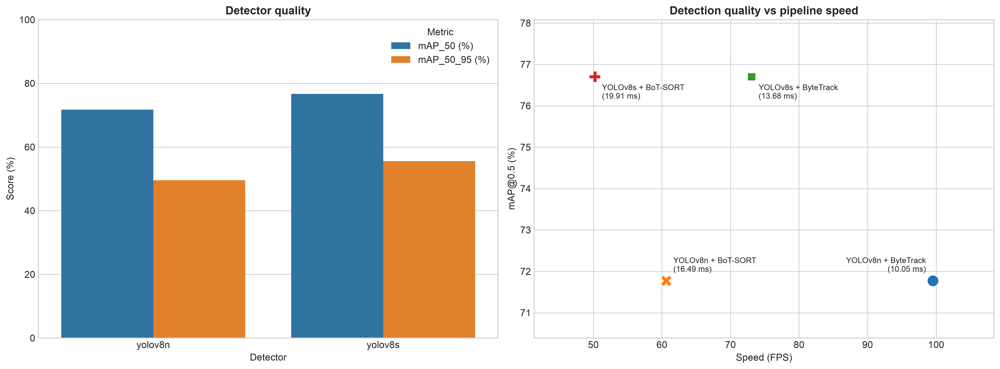
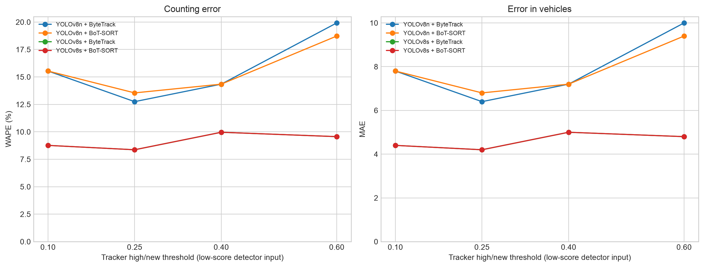

# Результаты восстановленного проекта

Источник всех численных результатов: `../runned/`, основной RTX 3060 прогон **run_20261103_170422**. Исходная папка не изменена. Графики и таблицы ниже заново построены в этом репозитории из импортированных данных.

| Данные | Папка |
|---|---|
| Main MOT и timing, dev/test | [tracks_run_20261103_170422](tracks_run_20261103_170422/) |
| Dev-графики | [reports_run_20261103_170422/dev/charts](reports_run_20261103_170422/dev/charts/) |
| Dev-таблицы | [reports_run_20261103_170422/dev/tables](reports_run_20261103_170422/dev/tables/) |
| Test-графики | [reports_run_20261103_170422/test/charts](reports_run_20261103_170422/test/charts/) |
| Test-таблицы | [reports_run_20261103_170422/test/tables](reports_run_20261103_170422/test/tables/) |
| Полные 16 условий ablation | [ablation_run_20261103_final](ablation_run_20261103_final/) |
| Ablation-графики | [ablation_run_20261103_final/analysis/charts](ablation_run_20261103_final/analysis/charts/) |
| Ablation-таблицы | [ablation_run_20261103_final/analysis/tables](ablation_run_20261103_final/analysis/tables/) |
| Сведения об импорте и проверки | [import_review_run_20261103_170422](import_review_run_20261103_170422/) |

Main JSON/Markdown оценки находятся в [../reports/run_20261103_170422](../reports/run_20261103_170422/).

## Test: основное сравнение

## Ablation: чувствительность counting

Финальные результаты и экспорты разрешены в Git точечными правилами .gitignore. Датасет, веса, выполненные notebook-копии и кэши остаются локальными. Полный inference при восстановлении не запускался. Ablation меняет high/new трекера при detector cutoff=0.1; это не detector-only sweep.
